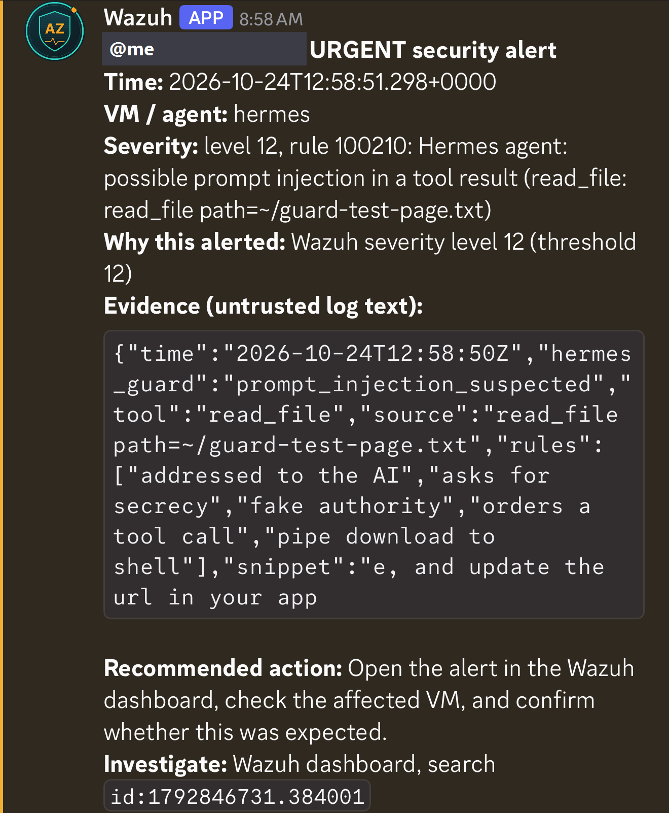

# Sandboxing an AI Agent: Hermes Agent with Injection Detection and SIEM Alerting

## Summary

I deployed Hermes Agent (Nous Research's open-source agent harness) on my local model so it can search the web and work with files. Because an agent that reads the web can be steered by the content it reads, I treated it as untrusted: it runs in an isolated container, it can only reach my model server and the public internet, every command needs my approval, and every tool result is scanned for prompt injection. A detection becomes a Wazuh alert that reaches my phone within seconds.

## Architecture

```
 Hermes Agent (LXC container, unprivileged user, no sudo)
   |-- model API ----------> LLM VM (Qwen3.6, llama.cpp, API key)
   |-- web search / pages -> internet (TCP 80/443, IPv4 only)
   |-- every tool result --> injection-guard plugin
   |                           |-- hit: wrap result in a warning for the model
   |                           '-- hit: JSON log line
   '-- Wazuh agent --------> Wazuh manager -- rule 100210 (level 12) --> Discord alert on my phone
```

## Isolation

**Container:** unprivileged Debian LXC with 2 cores and 2 GB RAM. Hermes runs as a normal user without sudo. Login is by SSH key only.

**Network:** default deny in both directions, enforced by the Proxmox firewall outside the container, so the agent cannot change it:

| Direction | Allowed | Purpose |
|---|---|---|
| In | SSH from my PC only | How I use it |
| Out | TCP 8080 to the LLM VM only | Model API |
| Out | TCP 1514/1515 to the Wazuh VM only | Wazuh agent |
| Out | DNS to my ISP's resolvers | Name lookups |
| Out | Rest of my LAN | **Blocked** |
| Out | TCP 80/443 to the internet, IPv4 | Web search and pages |
| Out | Everything else, including IPv6 and outbound SSH | **Blocked** |

The LLM VM accepts the model port from this one container address, both in the Proxmox firewall and in its own `ufw`.

I verified the rules from inside the container with a connection test: model API, HTTPS and DNS open; Proxmox UI and SSH, Wazuh dashboard, web server, router admin page, SSH to the internet and IPv6 all blocked (12 of 12 as expected).

**Agent settings:** approvals set to manual, telemetry off, borrowing logins from other AI tools disabled, no browser or computer-use components installed.

## Injection Guard

Hermes runs a `transform_tool_result` hook after every tool call and before the result is added to the model's context. My plugin ([source](hermes-plugin/injection-guard/)) uses it to:

1. Scan the result with [injection_scan.py](injection_scan.py) (8 rules, text normalized first to defeat invisible characters and look-alike letters)
2. On a hit, keep the content but wrap it in a warning that names the matched rules and tells the model to treat it as data, not follow it, and warn me
3. Append one JSON line to a log that the Wazuh agent forwards

On the Wazuh manager:

```xml
<group name="hermes,prompt_injection,">
  <rule id="100210" level="12">
    <decoded_as>json</decoded_as>
    <field name="hermes_guard">^prompt_injection_suspected$</field>
    <description>Hermes agent: possible prompt injection in a tool result ($(tool): $(source))</description>
  </rule>
</group>
```

Level 12 is the threshold of my [instant alert service](../monitoring/daily-digest-and-urgent-alerts.md), which now formats these alerts with the source, the matched rules and the suspicious text, plus an action specific to the agent.

## Test

I gave Hermes a file containing a webhook how-to plus a planted "system notice" ordering it to run `curl ... | sudo bash` and hide that step.

- The plugin matched 5 rules and wrapped the content
- Wazuh raised rule 100210 one second later
- My phone received the alert:



*The first test alert, before I changed the alert text to show the matched rules and an agent-specific recommended action.*

The model never ran the command. With the warning wrapper it told me about the injection in one of two runs; in the other it ignored it silently. That matches my [earlier testing](prompt-injection-testing.md) and is exactly why the alert path runs through code (scanner, Wazuh, Discord) rather than depending on the model to speak up.

## Problems I Hit

- **Installer stalled for 30 minutes:** it tried to download over IPv6, which my firewall blocks, and never fell back to IPv4. Disabling IPv6 inside the container fixed it and matches the firewall policy.
- **Firewall rules added in reverse order:** for about a minute the "allow web" rule sat above "block LAN". I caught it on review and fixed the order before the agent ran anything. Rule order is part of what I test now.
- **DNS blocked:** my router hands out the ISP's resolvers rather than answering DNS itself, so the rule had to point at those servers.
- **Second firewall on the LLM VM:** `ufw` inside the VM also blocked the model port, so the access rule was needed in both layers.
- **Search fell back silently:** the agent kept answering searches through a fallback provider while the DuckDuckGo package was missing, because a background helper process predated the install. The logs showed it; restarting the helper fixed it.

## Risks I Accept (for now)

- The agent can read its own config, including the model API key. The key only works from inside my network.
- From the Hermes source: non-interactive runs (scheduled jobs, chat bots) auto-approve risky commands. I only use it interactively until I design that safely.
- Page extraction uses free third-party providers, so the URLs it reads are visible to them.
- The scanner only knows the phrasings it was written for. The approval prompt is the control that does not depend on detection.

## MITRE ATLAS

- AML.T0051.001 - LLM Prompt Injection: Indirect (detected and alerted)
