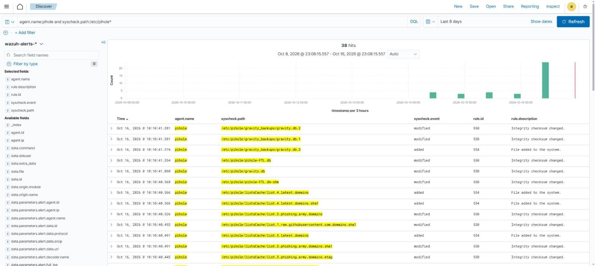

# File Integrity Alerts on /usr/bin and /etc/pihole (Rules 550 / 553 / 554)

## Summary

Wazuh file integrity monitoring (syscheck) produced a large number of alerts for changes under `/usr/bin/` and `/etc/pihole/`. After looking into them, I found they were routine system activity and not tampering.

## Observed Behavior

Over an 8-day window:

- `/usr/bin/`: 762 events across four hosts, with about 485 on a single day (Oct 12)
- `/etc/pihole/`: 38 events on my Pi-hole host

Changed attributes were mostly inode and modification time, with checksums changing on files that were actually replaced.

## Findings

- **`/usr/bin/`**: the bursts line up with package activity in the Wazuh dpkg alerts. I checked the apt history on each host. The changes were made by `unattended-upgrade` (Ubuntu automatic updates), plus a few installs I ran myself (Tailscale, the Wazuh agent, Pi-hole prerequisites). The Oct 12 batch included a kernel update on several hosts.
- **`/etc/pihole/`**: Pi-hole's own query database (`pihole-FTL.db` and its WAL files), version file and downloaded blocklist copies. These change constantly by design. The Oct 16 burst matches me adding more blocklists.

*Wazuh Discover, last 8 days: 38 file integrity alerts on the Pi-hole host, all under `/etc/pihole/` (the gravity database, the blocklist cache and the query database). Times are shown in local time (UTC-4).*

## Outcome

- No unexplained binary changes
- No evidence of tampering

## Tuning Applied

- The Wazuh agent on the Pi-hole host now ignores the database and blocklist cache files
- My daily digest collapses file changes in system folders only when the same host had package activity within 3 hours, so a change with no matching update still shows up
- Rule 510 "trojaned file" alerts for `diff` on all hosts are a known false positive, so they are counted and not listed

## Analyst Notes

File integrity monitoring is only useful if the noise is understood. The check that mattered was matching each change against package manager history. A change with no package activity behind it is the one to investigate.
