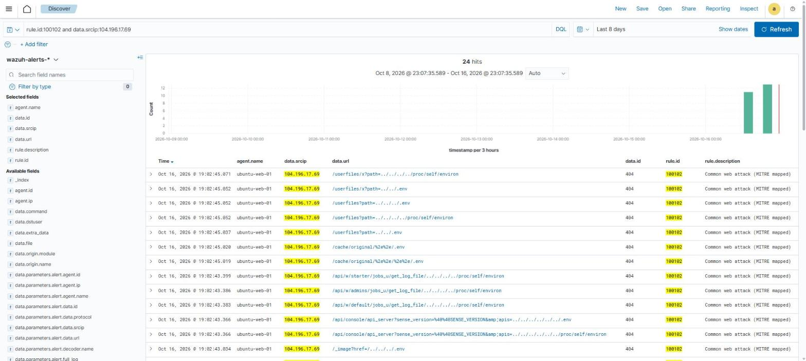

# Path Traversal From a Spoofed Crawler (Rule 100102)

## Summary

A Google Cloud host (104.196.17.69) sent about 660 requests to my web server over roughly six hours, including encoded directory traversal attempts and a POST to a PHP file, while presenting the user-agents of legitimate search and AI crawlers.

## Observed Behavior

Window: Oct 16, 16:44 to 23:02 UTC.

Notable requests:

- Traversal attempts aimed at `.env` and `/proc/self/environ`, flagged by Rule 100102 (24 alerts), for example:
  - `GET /api/uploads/%2e%2e%2f%2e%2e%2f.env` (URL-encoded `../../.env`)
  - `GET /userfiles?path=../../../../proc/self/environ`
  - `GET /api/w/default/jobs_u/get_log_file/../../../../proc/self/environ`
  - `GET /cache/original/%2e%2e%2f%2e%2e%2f.env`
- `POST /lib/terminal-xhr.php`, flagged by Rule 100100
- An attempt to read `.htpasswd`

User-agents claimed during the activity:

- `Mozilla/5.0 (compatible; KimiBot/1.0; +https://kimi.ai/)`
- `Mozilla/5.0 (compatible; Bravebot/1.0; +https://brave.com/search/)`

*Wazuh Discover, last 8 days: 24 Rule 100102 alerts from this one address, all HTTP 404. Times are shown in local time (UTC-4).*

## Outcome

- Nearly all requests returned HTTP 404
- The `.htpasswd` request was refused by Apache (403, "client denied by server configuration")
- No file was exposed

## MITRE ATT&CK Mapping

- Tactic: Initial Access
- Technique: Exploit Public-Facing Application (T1190)
- Tactic: Reconnaissance
- Technique: Active Scanning (T1595)

## Reputation

I checked this address on Oct 17 against SANS ISC DShield and AlienVault OTX. There were no reports and no threat-intel pulses for it. Its behavior is clearly hostile even though it is unlisted.

## Analyst Notes

Real crawlers do not send encoded traversal payloads or POST to PHP scripts, so the bot names appear to be spoofed to look harmless. This is based on behavior only. I did not verify the bots against the operators' published IP ranges. It is a good reminder that a user-agent alone should never be trusted when triaging alerts.
